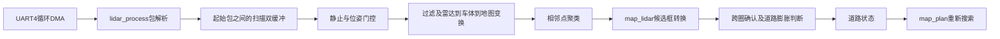

# 工训雷达到道路地图专项检查

检查日期：2026年10月3日。工程：`E:\code\gongxun\gongxun_1`，分支：`vision`。
检查前源码已保存为本地提交 `6c09dfa`，包括已有地图、雷达标定和视觉源码。

本轮目标是软件检查、确认问题的小范围修复、可重复验证与实车验收说明。
用户尚未完成实车安装标定；当前 `main.c` 继续运行 `lidar_install_test()`。
以下软件结果不代表已经烧录、车辆避障完成或D6能检测真实细杆。

## 数据实际怎样流动



这条图表示模块的接口链。当前运行入口只到安装标定测试，图中的地图链尚未在主循环启用。

| 层 | 当前源码与约定 |
|---|---|
| 接收 | `Core/Src/usart.c`：UART4，230400波特率，PC10/PC11，RX循环DMA。雷达直接轮询DMA缓冲，不经过RingBuffer，也没有FreeRTOS任务。 |
| 包解析 | `BSP/Src/lidar.c`：`AA 55`、10字节头、3字节一个点，最多25点。XOR与帧内小端CS比较；合法零CS可通过。 |
| 发布 | `lidar_scan_start()`用有效起始包结束上一圈，交换两个缓冲。每个整数角只保留最近距离，`raw_count`是原始采样数，`valid_count`是有效整数角数量。 |
| 读取 | 当前解析、取scan指针、点云和聚类都在主循环串行调用；中断只记录接收进度/错误，不发布点云。消费者使用`scan_num`去重。 |
| 门控 | `Control/Src/task.c`：只在软件底盘状态IDLE时生成点云；地图入口另检查配置、位姿、场地范围。恢复后丢弃旧圈和跨恢复时刻的圈。 |
| 点云 | `APP/Src/obstacle_find.c`：清空上一圈每角结果，筛掉无效/越界距离和启用的轮遮挡，然后统一用同一位姿变换。保存原`scan_num`。 |
| 聚类 | 按空间距离100mm连接，允许缺2角，缺3角断开，至少3个有效整数角。圆周边界与其他位置使用同一规则。 |
| 地图适配 | `APP/Src/map_lidar.c`：校验`obstacle_result.cloud_flag == cloud.update_flag`，传递`cloud.scan_num`；使用中心和整个包围框。 |
| 地图更新 | `APP/Src/map_update.c`：120mm跨圈配对、30mm同圈去重，两次出现确认；候选允许漏一圈、连续漏两圈删除。确认框加车体外接半径及安全余量，影响哪条道路就封锁哪条。 |
| 规划 | `APP/Src/map_plan.c`：9节点、12道路搜索。允许UNKNOWN成为候选路径时仍返回SCAN；BLOCKED排除，旧路径需重新检查或搜索。 |

`scan_num`是发布编号；采样丢失、坏包或中断后的物理完整性仍需下述限制和实车证据。
聚类中心是回波点坐标的平均值，不是已经估计出的杆圆心；包围框是观测点的地图坐标边界。
`nearest_distance`只是到雷达的最近距离标量，没有对应的最近点坐标；当前地图使用中心配对、包围框封路。

## 本轮修复及触发证据

| 问题 | 原来的触发结果 | 本轮改动 |
|---|---|---|
| 未标定轮遮挡误删0度 | 四组`0~0`占位范围仍会删除有效0度点 | 增加`LIDAR_WHEEL_MASK_ENABLE`，默认0；填好且实车复核后启用。启用时`0~0`确实表示一个角。 |
| 跨零小目标提前丢失 | 359侧2点、0侧2点，分别不足3点，先被丢弃再尝试合并 | 从实际断开处环形遍历，完整分组后再判断最小点数。 |
| 首尾缺点规则不同 | 其他位置允许缺2角，跨零却要求严格命中359和0 | 环形遍历统一缺点与距离规则；旋转到全部360个位置的同组目标结果一致。 |
| 位姿恢复接受半运动圈 | 已处理10，恢复时已发布11、12还在采；原入口随即接受12 | 先记录11，再丢12，仅允许后续完整13。即使pose_valid仍为1，非IDLE也重置门控。 |
| 非法单节点路径误通过 | 节点255或9、没有道路可遍历时`map_plan_check()`返回成功 | 检查路径中每个节点编号，合法单节点仍可通过。 |
| UART4错误停止DMA后不恢复 | 本地HAL在DMA接收错误路径终止RX，用户回调无UART4处理 | 中断置恢复标志，主循环重启接收、清除残包/工作半圈；启动失败保留标志并重试。 |
| 损坏起始包使两圈混合 | 坏CS起始包被直接略过，上一圈继续接收下一物理圈的数据 | 坏CS、非法长度/角度等已知坏帧丢弃工作扫描，等待下一有效起始包。保留此前已发布圈用于显示。 |
| DMA下标相等掩盖已观测满环 | 主循环迟读一环后，读写下标相同，原代码以为空缓冲 | 利用真实DMA完成回调累计生产进度及NDTR快照；已观测满环/覆盖时丢弃并重新同步。 |

改动沿用现有函数命名、分隔注释和中文说明，没有改写底盘状态机或实测安装参数。
聚类数组的顺序可能随环形起点变化；地图原本按位置配对，不能依赖“C0永远是某个物体”。

## 验证入口与结果

在工程目录运行：

```powershell
.\Test\Host\run_checks.ps1
```

脚本会找本机GCC或当前CLion自带的MinGW GCC，也支持用`-Compiler`指定路径。
它直接编译工程里的C算法；硬件替身仅提供HAL状态、DMA字节/进度、时钟或任务输入。
输出与可执行文件放在被Git忽略的`build/host_checks`，测试源文件保存在`Test/Host`。

| 检查套件 | 覆盖 |
|---|---|
| `test_lidar.c` | 23项；CS零值、距离强度、LSN0、25/26点、两点跨零、最近点、坏起始包、DMA恢复/失败重试、已观测覆盖和TC竞争。 |
| `test_cluster.c` | 20项；默认遮挡关闭及显式启用两种构建，跨零小段、缺2/3角、100mm边界、噪声、容量20/21、圆周旋转一致性。 |
| `test_map.c` | 原`map_stage_test()`18项，加28项主机检查；候选过期、重复、跳圈、配置、来源一致性、道路状态与路径参数。 |
| `test_pipeline.c` | 8项；合成scan→真实TF→真实聚类→地图→规划，确认R8封锁/绕行、旋转后R3封锁及空圈持久状态。 |
| `test_task.c` | 16项；完整真实task.c，恢复旧圈/跨界圈/新圈、重复、无配置、非法位姿和移动状态。 |

修复前检查点的相同回归曾复现：聚类6项失败、地图参数2项失败、任务门控5项失败（部分是同一时序错误的连带结果）。
本轮完成后各套检查全部通过。ARM Debug清理后重新编译并链接，76/76步通过；RAM 31752字节，FLASH 93864字节。
最终Debug固件为`build/Debug/gongxun_1.elf`，SHA256：`E194B5B7FFC15AC824354D2D8C139589028F2726EE7ADE27AA3DEE2FA3E2BE31`。
本轮没有烧录或板上检查。合成杆只是几何输入，不能证明真实杆产生同样回波。

## 现在仍不能由软件检查代替的事情

1. **安装变换待实测。** `tf_base`仍是`(0,0,0)`。倒装雷达的镜像方向、安装角、X/Y偏移必须用安装测试结果确定。
2. **地图角度必须统一。** 车体坐标是X向右、Y向前，TF的yaw是车体轴相对场地轴的旋转；TF yaw=0表示车头朝场地+Y。`control.c`约定my_yaw=0车头朝场地+X。若实测证实my_yaw正向为逆时针且零点为东，数学换算应为`tf_yaw = my_yaw - 90度`；当前不能直接把未经确认的my_yaw传进地图。
3. **位姿还没有生产提供者。** 旧`task_state.cur_x/y`是5×5格坐标，而且旧控制在发出运动命令时便更新，不能当成已到达的毫米位置。地图验收先使用卷尺确定的静止坐标。
4. **细杆每圈点数未知。** 聚类3点门槛按有效整数角计数，不是原始采样数；1～2角反复命中也不会进入当前地图跨圈确认。安装测试PASS不代表细杆聚类PASS。
5. **道路放行没有实现。** 空扫描不能证明没有细杆，因此仍保持UNKNOWN；已确认BLOCKED不自动超时清除。未来明确观测覆盖/放行证据后再实现清除，不能只凭一次漏扫放行。
6. **新地图规划尚未接底盘。** `control.c`仍使用旧`bfs.c`的自有地图。`map_update_change_get()`只是变化通知，控制层还没有用它触发搜索。未实现UNKNOWN停扫、BLOCKED停驶重规划以及新路径逐路段执行。
7. **物理静止与软件IDLE不同。** 任务门控只证明状态判断；还需验证减速、惯性和停稳时间。
8. **接收完整性有前提。** 230400波特率、8N1下512字节约22.2ms；必须及时处理DMA数据，TC中断也要及时服务。多个整环在长时间屏蔽中断时可合并硬件标志，计数不能还原。入口快照也不证明CPU处理期间绝不会被DMA追上。整包起始标记若静默丢失且没有错误事件，仍可能跨物理圈收集。扫描时间是CPU解析起始包时的时间，不是每点硬件采样时刻。

此外，格子分带采用半开区间，静态禁入矩形包含上边界；例如`(1000,775)`可获得R9格编号，但`map_check_area()`判为禁入。
当前地图按后者过滤。格子归属不能当作通行许可，后续依据赛题/现场边界规则统一。

## 实车验收顺序

每步保留固件版本、原始串口记录、测量位置和PASS/FAIL；前一步未通过，不进入带动作的后一步。

| 步骤 | 操作与记录 | 通过条件 |
|---|---|---|
| 1 接收 | 车固定，连续采100圈，记录scan_num、start/end、raw_count、valid_count、xor成功/错误和恢复/丢圈计数 | 新圈持续出现，计数和周期可解释；无无法恢复的停更。主动故障恢复只在有测试串口设备时进行，主机替身成功不替代实测。 |
| 2 安装 | 当前入口按KEY1依次采背景/前/右/左挡板各100圈，先填写卷尺实测参考坐标 | 各方向命中与拟合质量通过，保留`INSTALL RESULT sign/tx/ty/yaw/rms`，再审查写入正式变换。 |
| 3 轮遮挡 | 换车位或方向复测原始轮范围，确认回波确实随车而不是固定环境 | 同一车体遮挡在变化环境仍成立，填写四组范围并启用掩码，外部目标没有被误删。 |
| 4 真实细杆 | 用赛题尺寸/高度的杆，在500/1000/1500mm及实际关键距离各固定采100圈；若现场距离不同则按现场记录 | 区分原始命中率、过滤后角数、聚类命中率和坐标波动。每圈不足3角时记录失败，不用合成测试替代。稳定性目标需结合比赛允许漏检程度确定。 |
| 5 静止地图 | 实测车位在N4，车头朝场地+Y；在约`(1200,1625)`位置放杆，配置真实机构外接尺寸/余量 | 车体/地图坐标正确；第1有效圈候选，第2次命中确认R8，其他出口状态符合几何。再在N4附近放杆验证四出口封锁。 |
| 6 状态与规划 | 对上一步已确认障碍移走杆或制造漏扫，检查地图及旧/新路径 | BLOCKED保持，旧路STOP，新路避开R8；其余UNKNOWN仍要求SCAN。只有明确放行后才可GO。 |
| 7 控制接入 | 以后统一节点编号/毫米坐标、停稳/到达反馈、位姿有效条件，再逐道路段执行 | 未知道路停扫、封锁道路停车重规划、无路停车；先单段低速，再完整任务。当前版本尚未实现此步。 |

新增接收诊断函数：`lidar_get_rx_error_cnt()`、`lidar_get_dma_overrun_cnt()`、`lidar_get_scan_drop_cnt()`。
`overrun`统计的是检测到的满环或覆盖事件，不是精确丢失字节数；计数为0也不能排除未观测的整环。

本轮软件交付的停止条件：确认问题有可审查修改、主机检查可重复通过、固件重新构建通过、实车操作和剩余限制已写明。
下一步是完成当前安装标定，再决定正式TF与静止地图测试入口；本轮没有转入回放工具或底盘大改。
